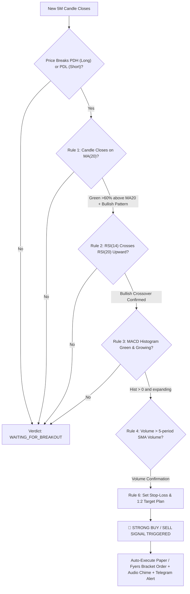

# 🚀 QUANT PILOT - Intraday Trading Assistant

> **A professional quantitative intraday trading station for the Indian Share Market (Nifty 50, Bank Nifty, Fin Nifty, MCX Crude Oil, and High-Beta Equities).**  
> Designed to run in desktop browsers on Windows and continue running 24/7 on free cloud hosting so you can monitor, receive alerts, and execute paper/real trades from **Safari on your iPhone** after shutting down your laptop.

---

## 📋 Table of Contents
1. [Core Features](#-core-features)
2. [The 6 Intraday Quant Rules Explained](#-the-6-intraday-quant-rules-explained)
3. [Supported Instruments](#-supported-instruments)
4. [Windows Laptop Quickstart (Local Run)](#-windows-laptop-quickstart-local-run)
5. [Free Cloud Deployment (24/7 Continuous Access)](#-free-cloud-deployment-247-continuous-access)
   - [Method A: Hugging Face Spaces (Recommended - 100% Free 24/7)](#method-a-hugging-face-spaces-recommended)
   - [Method B: Render.com (Free Web Service)](#method-b-rendercom)
   - [Method C: Railway / Fly.io](#method-c-railway--flyio)
6. [iPhone Safari Access & Add to Home Screen](#-iphone-safari-access--add-to-home-screen)
7. [Paper Trading & Real Money Trading (Fyers API)](#-paper-trading--real-money-trading)
8. [Instant Telegram Lock-Screen Alerts](#-instant-telegram-lock-screen-alerts)
9. [Architecture & Project Structure](#-architecture--project-structure)

---

## 🌟 Core Features

- **24/7 Cloud Availability**: Hosted independently on free cloud platforms. Close your laptop, and the quant engine keeps running.
- **iPhone Safari Optimized (PWA)**: Mobile-first responsive UI with bottom navigation bar, safe-area insets, touch-friendly tap targets, and Web Audio API alerts.
- **Live TradingView Lightweight Charts**: Smooth interactive 5-minute candlestick chart with MA(20) line, Volume sub-chart, RSI(14/20), MACD histogram, and real-time PDH/PDL levels.
- **Rule-by-Rule Live Scanner**: Real-time evaluation matrix showing clear green/red status for each of the 6 quant rules across all watchlist instruments.
- **Built-in Paper Trading Simulator**: Virtual ₹1,00,000 wallet, automated bracket order execution, SL and 1:2 Target monitoring, and trade logs matching your existing CSV bot formats.
- **Real Trading Ready**: Direct integration with **Fyers API v3**, including automated option strike selection (ATM CE for Longs, ATM PE for Shorts) and Bracket Orders (BO).
- **Multi-Source Market Data**: Connects to Fyers WebSocket/REST when available, with free real-time intraday market feeds and offline simulation replay for testing outside market hours.

---

## 🧠 The 6 Intraday Quant Rules Explained

Quant Pilot evaluates these precise intraday rules on 5-minute candles:



### Detailed Breakdown:

1. **Pre-condition (Rule 5 & Header): Previous Day High (PDH) & Low (PDL) Breakout**
   - **For Longs**: Price must break above Previous Day High ($PDH$).
   - **For Shorts**: Price must break below Previous Day Low ($PDL$).
   - *If price is trapped within yesterday's range, the scanner waits for breakout to prevent choppy false signals.*

2. **Rule 1: Candle Closes on MA(20) Line**
   - **Long**: Green candle ($Close > Open$) closes on/above MA(20). Most of the candle body/range ($> 60\%$) must be above MA(20).
   - **Short**: Red candle ($Close < Open$) closes on/below MA(20). Most of the candle body is below MA(20).
   - **Candle Pattern Recognition**: Detects Bullish Engulfing, Hammer / Bullish Pin Bar, Marubozu, and strong continuation candles.

3. **Rule 2: RSI(14) Crossing RSI(20)**
   - **Long**: RSI(14) crosses RSI(20) from downward to upward (recent bullish crossover within lookback window).
   - **Short**: RSI(14) crosses RSI(20) from upward to downward (recent bearish crossover).

4. **Rule 3: MACD Histogram Green / Red**
   - **Long**: MACD Histogram is positive ($Hist > 0$) AND expanding ($Hist_t \ge Hist_{t-1}$).
   - **Short**: MACD Histogram is negative ($Hist < 0$) AND falling ($Hist_t \le Hist_{t-1}$).

5. **Rule 4: Volume > 5-period Volume Average**
   - Current candle volume must be greater than the simple moving average of the last 5 completed candles ($Volume > SMA(Volume, 5)$).

6. **Rule 6: Stop-Loss & Risk Management (1:2 Target)**
   - **Stop-Loss Calculation**:
     - Mode A: Previous 2 candles' Low (for Long) / High (for Short).
     - Mode B: Swing Low / Swing High (5-candle lookback).
   - **Target**: Formulated with a strict **1:2 Risk-Reward Ratio**:
     $$\text{Target} = \text{Entry} + (\text{Risk} \times 2.0)$$
   - **Position Sizing**: Automatically calculated so you never risk more than 1% of your capital per trade.

---

## 📊 Supported Instruments

| Symbol | Name | Exchange | Segment | Lot Size |
|---|---|---|---|---|
| `NSE:NIFTY50-INDEX` | Nifty 50 Index | NSE | Index / F&O | 25 |
| `NSE:NIFTYBANK-INDEX` | Bank Nifty Index | NSE | Index / F&O | 15 |
| `NSE:FINNIFTY-INDEX` | Fin Nifty Index | NSE | Index / F&O | 25 |
| `MCX:CRUDEOILM-FUT` | Crude Oil Mini | MCX | Commodity | 10 |
| `NSE:HDFCBANK-EQ` | HDFC Bank Ltd | NSE | Equity | 1 |
| `NSE:RELIANCE-EQ` | Reliance Industries | NSE | Equity | 1 |
| `NSE:TCS-EQ` | Tata Consultancy Services | NSE | Equity | 1 |
| `NSE:ICICIBANK-EQ` | ICICI Bank Ltd | NSE | Equity | 1 |

*You can also search or enter any custom NSE or MCX symbol.*

---

## 💻 Windows Laptop Quickstart (Local Run)

1. **Double-click `run.bat`** (or open PowerShell in this folder and run):
   ```powershell
   python main.py
   ```
2. Open your Windows browser (Chrome / Edge / Firefox):
   ```
   http://localhost:8000
   ```
3. You will immediately see the live Quant Pilot trading terminal with real-time charts, strategy breakdown, and paper portfolio.

---

## ☁️ Free Cloud Deployment (24/7 Continuous Access)

To access the app from your **iPhone Safari browser even when your laptop is turned off**, deploy it to one of these free cloud hosting services:

### Method A: Hugging Face Spaces (Recommended)
*100% Free, runs 24/7 without sleeping, 16GB RAM, 2 vCPUs, no credit card required.*

1. Go to [huggingface.co](https://huggingface.co) and sign in (free).
2. Click **New Space** ([huggingface.co/new-space](https://huggingface.co/new-space)).
3. Settings:
   - **Space Name**: `quant-pilot`
   - **License**: `mit`
   - **Space SDK**: Select **Docker** -> **Blank**.
   - **Space Hardware**: Free (2 vCPU, 16GB RAM).
4. Clone or upload this repository files (`app/`, `static/`, `templates/`, `Dockerfile`, `main.py`, `requirements.txt`).
5. Hugging Face will automatically build the Docker image in ~1 minute.
6. Your live URL will be ready:
   ```
   https://yourusername-quant-pilot.hf.space
   ```
7. Open this URL in Safari on your iPhone!

---

### Method B: Render.com
*Free Web Service tier, automatic deployments from GitHub.*

1. Push this folder to a GitHub repository.
2. Sign in to [render.com](https://render.com).
3. Click **New +** -> **Web Service**.
4. Connect your GitHub repository.
5. Render detects `render.yaml` or set:
   - **Environment**: Python 3
   - **Build Command**: `pip install -r requirements.txt`
   - **Start Command**: `python main.py`
   - **Instance Type**: Free
6. Click **Create Web Service**. Your app is live at `https://quant-pilot-xxxx.onrender.com`!

---

## 📱 iPhone Safari Access & Add to Home Screen

Quant Pilot is built specifically for **iOS Safari**:

1. Open Safari on your iPhone and visit your deployed Cloud URL (e.g., `https://yourusername-quant-pilot.hf.space`).
2. Tap the **Share** button (box with an upward arrow at the bottom of Safari).
3. Scroll down and tap **"Add to Home Screen"**.
4. Name it **Quant Pilot** and tap **Add**.
5. Quant Pilot will now appear as a **standalone app icon on your iPhone home screen** with full-screen view (no Safari address bar) and instant access!

```
+------------------------------------+
|  [QUANT PILOT]     NSE: OPEN [●]   |
|  NIFTY 50: ₹25,840.50 (+0.8%)      |
|  Signal: STRONG BUY (LONG)         |
+------------------------------------+
|                                    |
|       [ 5M Candlestick Chart ]     |
|         with MA(20) & PDH/PDL      |
|                                    |
+------------------------------------+
|  6-Rules Matrix:                   |
|  [✓] PDH Breakout (₹25,800 broken) |
|  [✓] Green Candle on MA(20) (85%)  |
|  [✓] RSI(14) > RSI(20) (Crossed)   |
|  [✓] MACD Hist Green (+12.4)       |
|  [✓] Volume > Avg 5 (1.8x surge)   |
|  [✓] SL: ₹25,720 | Target: ₹26,080 |
+------------------------------------+
| [Chart] [Scanner] [Trades] [Settings]
+------------------------------------+
```

---

## 💼 Paper Trading & Real Money Trading

### Paper Trading Mode (Default)
- Start with ₹1,00,000 virtual balance (reset anytime with 1 click).
- Tracks open positions, live unrealized PnL, margin used, and win rate %.
- **Automated Exits**: If price hits the 1:2 Target, it locks profit. If price hits Stop-Loss, it exits automatically.
- **CSV Trade Logging**: Appends every trade to `trade_logs/` in your exact previous format:
  ```csv
  Timestamp,Symbol,Action,Position_Type,Entry_Price,Quantity,Capital_Used,Exit_Price,PnL,Status
  2026-11-06 14:15:00,NSE:NIFTY50-INDEX,Entry(Buy),Index,25800.0,25,32250.0,26040.0,6000.0,Executed
  ```

### Real Money Trading (Fyers API v3)
When you are ready to trade real capital:
1. Tap the **Settings** icon (top right on laptop or bottom tab on iPhone).
2. Switch mode to **"Real Money (Fyers API)"**.
3. Enter your **App ID** and **Secret Key**.
4. Click **"Login With Fyers"** to generate your daily OAuth session token.
5. In Options mode, Quant Pilot automatically selects the **At-The-Money Call (CE)** for Long signals and **ATM Put (PE)** for Short signals from the live Fyers options chain, and places Bracket Orders with built-in Stop-Loss and Target protection!

---

## 🔔 Instant Telegram Lock-Screen Alerts

Get signal notifications on your iPhone even when your screen is locked:

1. Open Telegram and search for `@BotFather` -> create a new bot to get a `BOT_TOKEN`.
2. Message your bot, then get your `CHAT_ID` via `@userinfobot`.
3. In Quant Pilot Settings, enter your `Telegram Bot Token` and `Telegram Chat ID`.
4. Whenever all 6 intraday rules align, you'll receive an instant push notification on your iPhone:
   ```
   🚀🟢 QUANT PILOT INTRADAY ALERT 🟢🚀

   📈 Symbol: NSE:NIFTY50-INDEX
   🎯 Signal: BUY_SIGNAL (LONG)
   💵 Entry: ₹25,800.00
   🛑 Stop Loss: ₹25,720.00 (Risk: 80.0 pts)
   🏆 Target (1:2): ₹25,960.00
   🕯 Pattern: Bullish Engulfing

   ✅ Quant Rules Passed:
   • PDH/PDL Breakout: Confirmed
   • MA(20) Position: Verified (>60% above)
   • RSI(14) vs RSI(20): Bullish Crossover
   • MACD Histogram: Green & Expanding
   • Volume: > 5-period Moving Average
   ```

---

## 📁 Architecture & Project Structure

```
Quant Pilot Antigravity/
├── app/
│   ├── __init__.py
│   ├── config.py             # Watchlist, rule thresholds, risk parameters
│   ├── strategy_engine.py    # Quant brain: PDH/PDL, MA20, RSI, MACD, Vol, SL/TP
│   ├── market_data.py        # Multi-source feed (Fyers + Yahoo REST + 24/7 Simulator)
│   ├── paper_engine.py       # Paper trading wallet, margin, SL/TP monitor, CSV logger
│   ├── broker_fyers.py       # Fyers API v3 OAuth, option chain & Bracket Orders
│   ├── notifier.py           # In-app chimes & Telegram webhook dispatcher
│   └── web_server.py         # FastAPI async server & WebSocket stream
├── static/
│   ├── css/style.css         # iOS safe-area styling, custom dark quant theme
│   ├── js/app.js             # TradingView Lightweight Charts, WebSockets, Audio Synth
│   └── manifest.json         # PWA manifest for iPhone Safari Add to Home Screen
├── templates/
│   └── index.html            # Ultra-responsive mobile & desktop HTML5 dashboard
├── trade_logs/               # CSV trade records
├── Dockerfile                # Multi-cloud deployment (Hugging Face / Render / Railway)
├── render.yaml               # 1-click Render blueprint
├── requirements.txt          # Python dependencies
├── run.bat                   # 1-click Windows runner
├── main.py                   # Server entry point
├── test_quant_pilot.py       # Complete unit & integration test suite
└── README.md                 # Full documentation
```

---

## ⚖️ Disclaimer
*This application is for educational and algorithmic trading assistance purposes. Quant trading involves financial risk. Always thoroughly test your strategy using the built-in Paper Trading simulator before allocating real capital.*
# Quant-Pilot-Antigravity


=======


Check out the configuration reference at https://huggingface.co/docs/hub/spaces-config-reference
